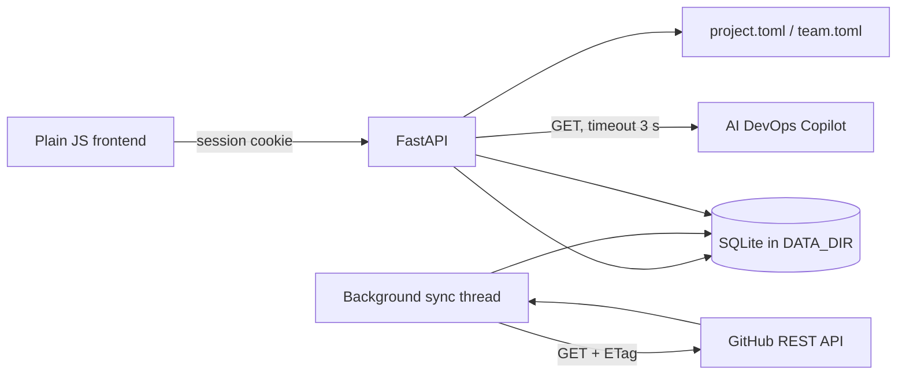

# Architecture

Helm is a read-only FastAPI application. The browser calls authenticated JSON endpoints; the server reads project/team TOML, GitHub REST GET endpoints, and optional Copilot GET endpoints. A polling thread refreshes repository data and writes it to the local SQLite database. The browser never receives the GitHub token.

SQLite tables:

| Table | Purpose |
| --- | --- |
| `sessions`, `failures` | Server-side sessions and login rate limits |
| `http_cache` | GitHub response bodies and ETags, keyed by URL |
| `prs`, `reviews`, `checks` | Current pull request, review, and check snapshots keyed by repository and source identifier |
| `repo_approvers` | Cached `.github/APPROVERS` contents by repository and base branch |
| `events` | Deduplicated activity entries, keyed by repository and stable event key |
| `sync_meta` | Repository sync timestamp, errors, request count, default branch |
| `github_request_log` | Rolling one-hour GitHub request budget |

Only configuration examples are committed. Real project/team TOML and SQLite data are local runtime state.
